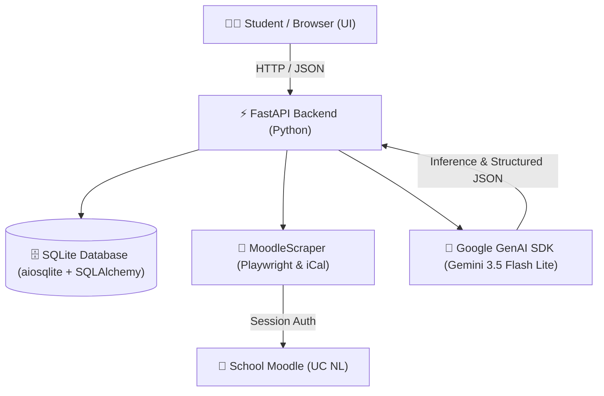

# 🎓 School Agent — Personal Academic AI Assistant & Moodle Companion

> **School Agent** is a privacy-first, autonomous academic assistant and learning management system (LMS) companion designed specifically for university students. It bridges the gap between fragmented school Moodle platforms, messy calendar feeds, informal teacher announcements, and personalized AI study assistance.

---

## 🌟 Executive Summary: What It Is & Why It Was Built

In modern online university platforms (such as Moodle), students frequently encounter critical usability hurdles:
1. **Disappearing Academic History:** Once a school term (*tetramestre* or semester) concludes, past classes and grades are often hidden or purged from student dashboards, leaving no permanent academic transcript.
2. **Lazy Teacher Notices & Unstructured Deadlines:** Professors often do not configure formal Moodle calendar items. Instead, assignments and rules are buried in conversational forum posts (e.g., *"subir el video MP4 de 30MB antes del domingo a las 23:59"*), emails, or topic descriptions.
3. **Generic Calendar Events:** Standard iCal exports contain vague event titles (e.g. *"Actividad de Regularización cierra"*) with no subject code or direct assignment link.
4. **Lack of Actionable Execution Plans:** Students see a deadline but lack an immediate, structured strategy to tackle the homework rubric step-by-step.

**School Agent** resolves all of these issues by pairing **Playwright browser automation**, **SQLite async database storage**, and **Google Gemini AI** (`gemini-3.5-flash-lite` & `gemini-3.7-flash`) in an intuitive single-page dashboard.

---

## 🚀 Core Features & What You Can Do

### 1. 📊 Permanent Academic Record & GPA Tracker
- **Permanent Multi-Term Archive:** Store and preserve all historical terms (e.g., *1er, 2do, 3er Tetramestre*) so your grades and course history are never lost during Moodle term resets.
- **Dynamic GPA Calculation:** Automatic computation of **Cumulative GPA (Promedio General)** and **Active Period GPA** across all accredited and in-progress subjects.
- **Visual Grade Badges:** Color-coded recognition (⭐ *9.5–10.0 Honor Roll*, *8.0–9.4 Passing*, *< 7.0 In Danger*).
- **Manual Backfill:** Easily add or edit historical terms and subjects that are no longer accessible on Moodle.

### 2. 📅 Smart Deadlines, Deep Course Scanner & AI Extractor
- **🔍 1-Click AI Deep Course Scanner:** Visits any course page (e.g., `https://licenciatura.ucnl.edu.mx/course/view.php?id=18919`), scans all quizzes (`mod/quiz`), homeworks (`mod/assign`), and section units, and accurately matches them to your subjects.
- **⚡ Clean iCal Synchronization:** Pulls live events from Moodle's iCal export feed, cleans repetitive boilerplate titles, and automatically links activities to enrolled courses.
- **✨ AI Natural Language Extractor:** Paste informal WhatsApp messages, emails, or teacher forum notices; Gemini extracts the clean title, computes the exact due date, extracts file constraints (e.g., MP4 format, file size limits), and populates your task board.
- **🤖 1-Click AI Execution Plan & Checklist:** Click **"AI Plan"** on any task to generate:
  - 🎯 **Executive Goal:** Clear deliverable summary.
  - ⏱️ **Estimated Time:** Accurate time budget (e.g., *1 - 2 hours*).
  - 📋 **Step-by-Step Breakdown:** Structured sequence with minute estimations.
  - ✅ **Interactive Checklist:** Interactive checkboxes to ensure full rubric points.
  - 💡 **Pro-Tips for 10/10:** Specific advice tailored to the subject.
- **🧠 Smart Cascading Filters:** Selecting a **Period** dynamically filters the **Course** dropdown to show only subjects from that period with live deliverable counts.
- **☑️ Bulk Selection & Glowing Action Bar:** Select multiple deliverables with a floating neon toolbar to complete, revert to pending, or delete in a single click.
- **📅 Direct Google Calendar Export:** Export individual tasks to Google Calendar or download the full dynamic `.ics` calendar feed.

### 3. 💬 Context-Aware Academic AI Assistant & Professor Email Drafter
- **Context-Aware Chat:** Gemini has real-time access to your enrolled courses, current grades, and pending deadlines. Ask questions like:
  - *"What courses did I take on the 3rd grade and what grades did I get?"*
  - *"Plan a balanced study schedule for my upcoming calculus exam."*
- **Multimodal Document Understanding:** Attach syllabi, assignment rubrics, PDF lecture notes, code snippets, or slide screenshots directly in chat.
- **✉️ AI Professor Email Drafter:** Generate polished, professional, urgent, or formal emails to professors for extension requests, office hour appointments, or grade inquiries with one-click clipboard copying.

### 4. 📚 Study Studio & Active Recall Flashcards
- **AI Lecture Summarizer:** Paste lecture transcripts, textbook excerpts, or notes; Gemini creates structured executive summaries with key concepts.
- **Interactive 3D Flashcards:** Auto-generate active recall question/answer study cards with smooth 3D flip animations.
- **Google Docs Export:** Export processed study notes directly to Google Docs format with one click.

### 5. 🔄 Moodle Synchronization Hub
- **Session-Preserving Browser Automation:** Launch a dedicated Playwright browser window once to log into your school portal. Your authenticated session is securely saved in `data/moodle_auth.json`.
- **Deep Grade Report Scraper:** Automatically navigates to `/grade/report/overview/index.php` to extract official final course titles and grades.
- **Instant iCal Feed:** Fast, zero-browser synchronization for instant deadline refreshes.

---

## 🛠️ Architecture & Technical Stack



| Layer | Technologies Used | Description |
|---|---|---|
| **Frontend** | HTML5, Tailwind CSS, FontAwesome 6, Marked.js | Modern, responsive dark-mode Single Page App with zero build/bundler requirement. |
| **Backend** | FastAPI, Uvicorn, Python 3.14, Pydantic v2 | High-performance asynchronous REST API with automatic SQLite migrations. |
| **Database** | SQLite via SQLAlchemy 2.0 (AsyncIO + aiosqlite) | Local, zero-latency database storing Terms, Courses, Assignments, Notes, and Chat history. |
| **Scraper** | Playwright Chromium, Requests, `icalendar` | Headless browser automation with persistent session context storage. |
| **AI Engine** | Google GenAI SDK (`google-genai`) | High-speed structured JSON generation and multimodal reasoning via Gemini models. |

---

## 📂 Project Directory Structure

```text
school-agent/
├── backend/
│   ├── ai_service.py       # Gemini API client, task extractor, breakdown planner, email drafter
│   ├── app.py              # FastAPI endpoints (CRUD for terms, courses, tasks, notes, chat)
│   ├── config.py           # Environment variables, API keys, paths, and settings
│   ├── database.py         # SQLAlchemy async models (Term, Course, Assignment, Note, etc.)
│   └── moodle_scraper.py   # Playwright deep scraper, overview grade parser, and iCal importer
├── data/
│   ├── moodle_auth.json    # Local browser session storage (cookies/storage state)
│   └── school_agent.db     # SQLite local database
├── static/
│   └── index.html          # Unified dark-mode Single Page Application
├── .env                    # Local configuration (GEMINI_API_KEY, MOODLE_URL, etc.)
├── about_this_project.md   # Comprehensive project documentation (this file)
├── main.py                 # Application launcher entry point
└── requirements.txt        # Python dependency manifest
```

---

## ⚙️ Quick Start & Usage Guide

### 1. Prerequisites
- Python 3.11+ (Python 3.14 fully supported).
- A free Google Gemini API Key from [Google AI Studio](https://aistudio.google.com/).

### 2. Installation
```powershell
# Clone or open the project folder
cd C:\Users\israf\DOCUMENTS\VSCODE\school-agent

# Install dependencies
pip install -r requirements.txt

# Install Playwright browser binaries
playwright install chromium
```

### 3. Launch the Server
```powershell
python main.py
```
Open your browser and navigate to:
```text
http://127.0.0.1:8000
```

### 4. Initial Setup (2 Minutes)
1. **Configure Gemini API Key:** Open the **Settings** tab and enter your Gemini API key (recommended model: `gemini-3.5-flash-lite`).
2. **Authenticate Moodle:** Go to **Moodle Sync Hub**, click **"Launch Browser & Log In"**, and log into your school portal. Close the browser window when done; your session is now saved locally.
3. **Run Initial Sync:** Click **"Run Auto Sync Now"** to extract all enrolled courses and overview grades.
4. **Paste iCal Feed (Optional):** In Moodle, go to *Calendar > Export calendar* and paste your iCal URL into the Moodle Sync Hub for instant calendar updates.

---

## 🔒 Privacy & Security

- **100% Local Storage:** All academic records, assignments, grades, and study notes remain strictly on your local computer in SQLite (`data/school_agent.db`).
- **Encrypted Local Sessions:** Session cookies are stored locally in `data/moodle_auth.json` and are never transmitted to third parties.
- **Direct AI Calls:** Prompts and homework questions are processed directly between your computer and Google's official Gemini API using your personal API key.

---

*Engineered with precision to give university students a modern, intelligent, and permanent academic command center.*
